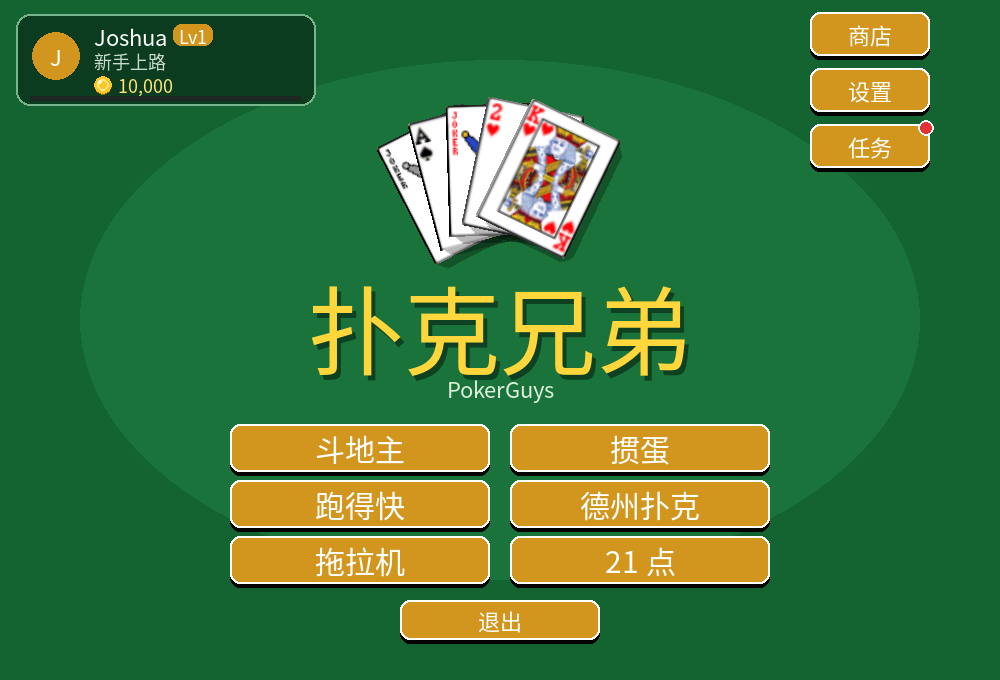
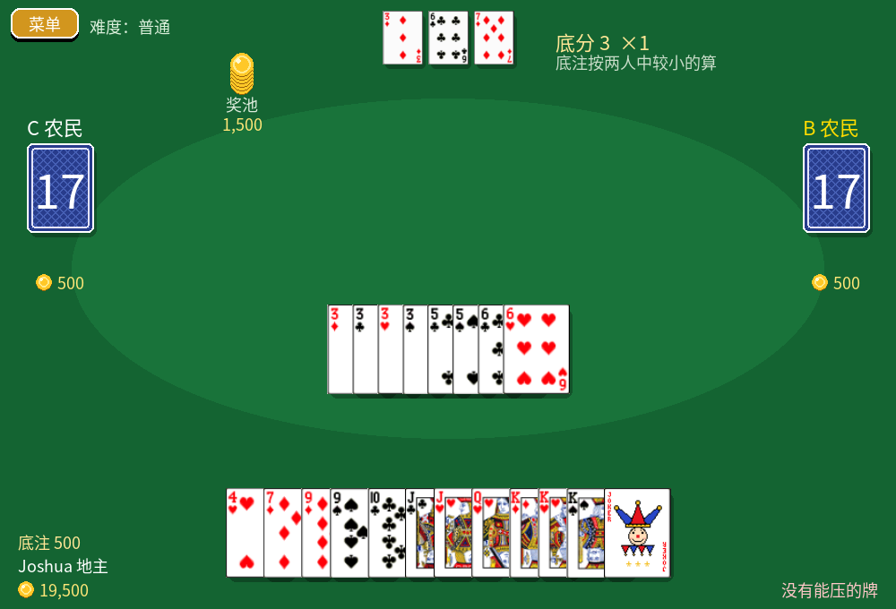
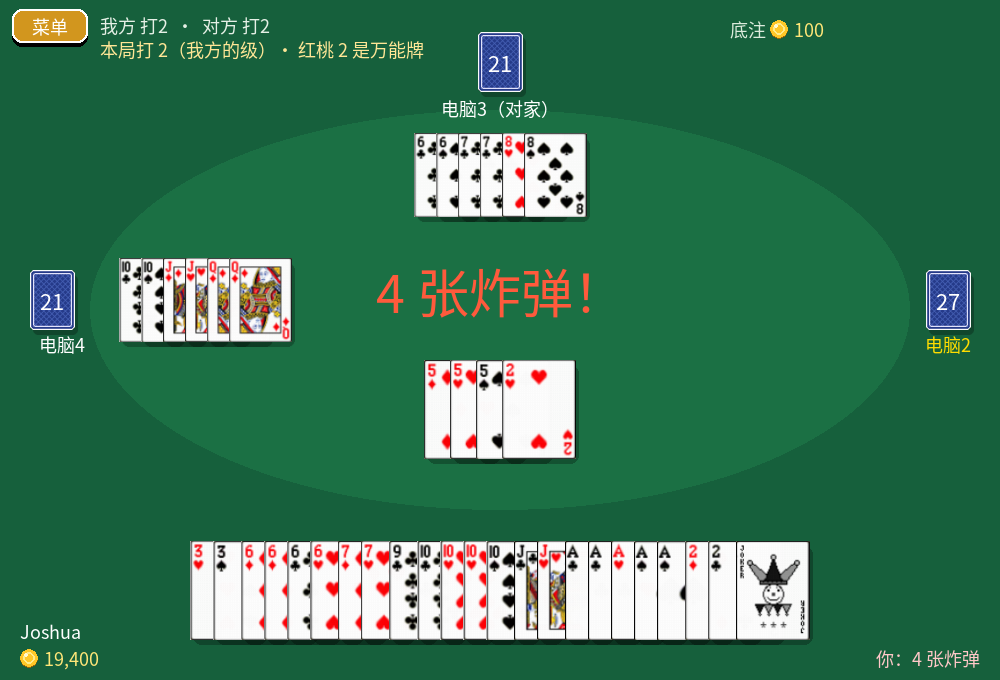
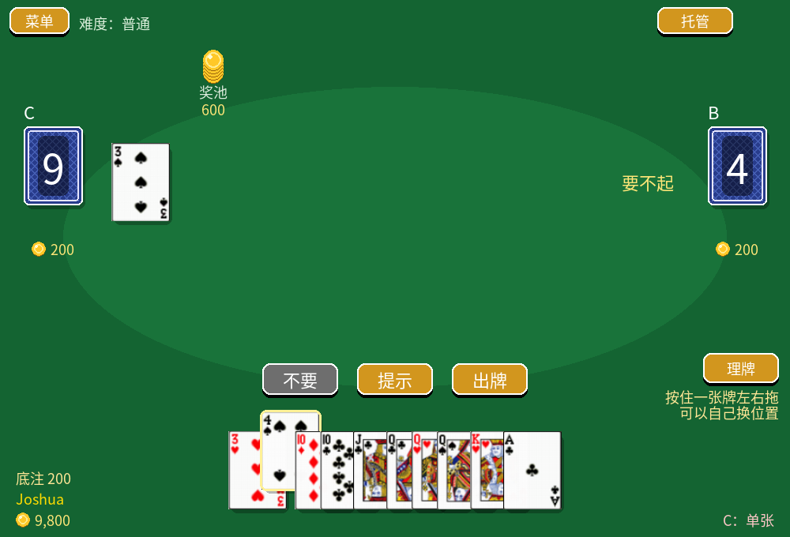
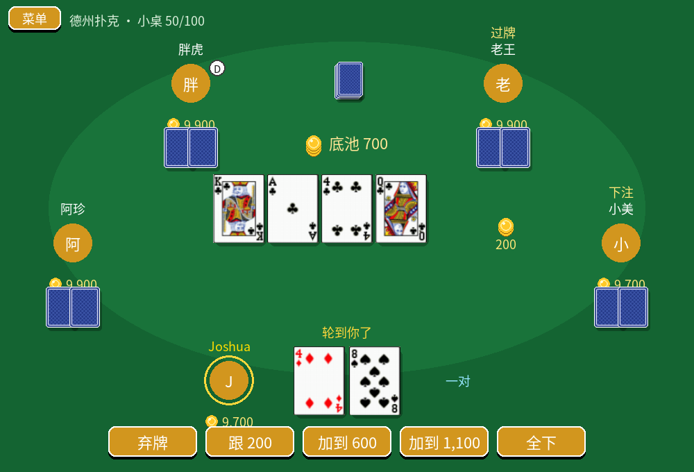
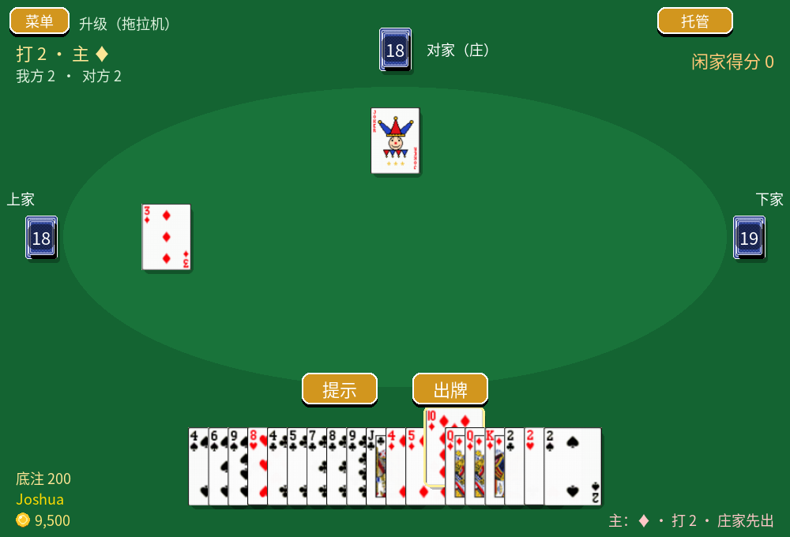
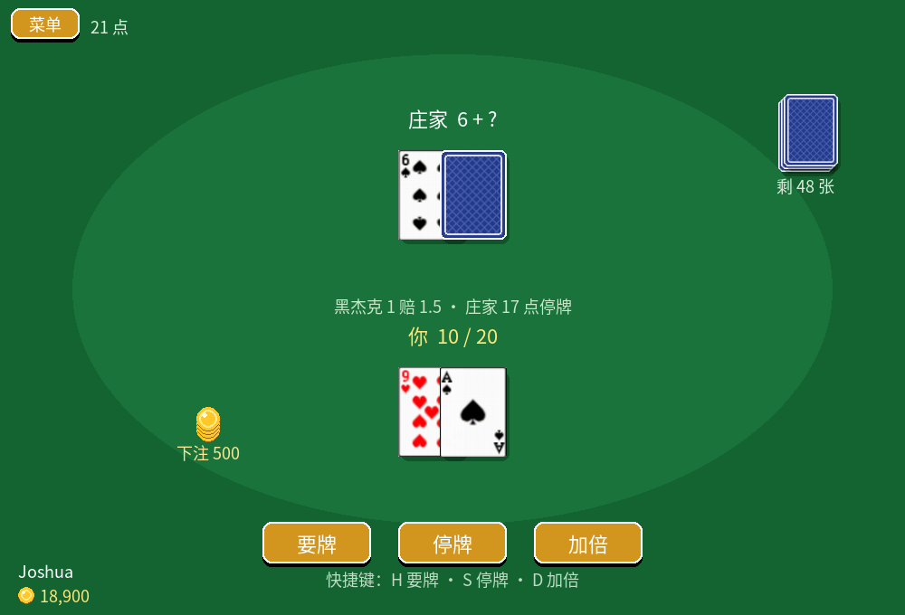
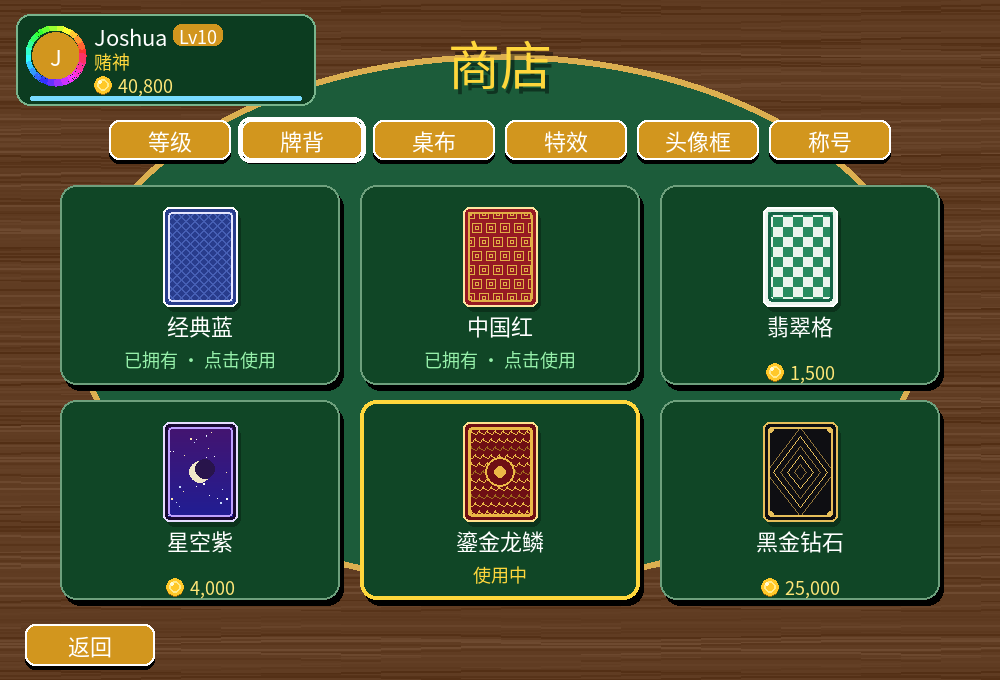
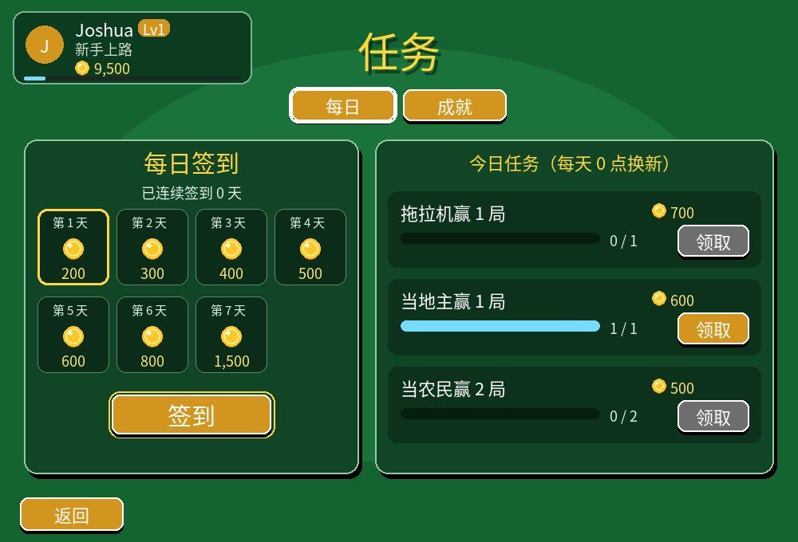
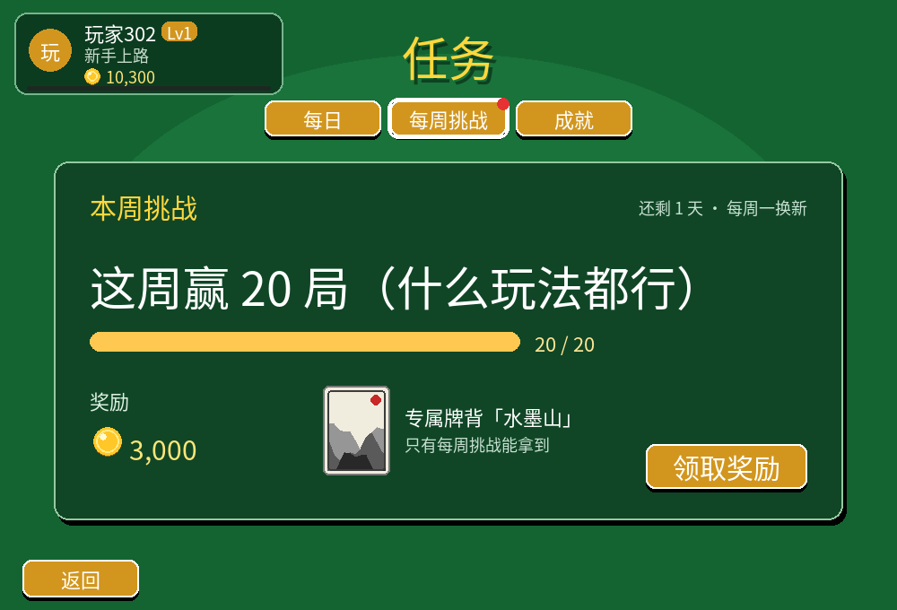

<div align="center">


# 扑克兄弟 PokerGuys

**斗地主 · 掼蛋 · 跑得快 · 德州扑克 · 升级（拖拉机）· 21 点 —— 六种玩法一个游戏**

单机打电脑，或者用房间号和天南地北的朋友联机

[](https://github.com/JoshuaMaoJH/PokerGuys-releases/releases/latest)
[](https://github.com/JoshuaMaoJH/PokerGuys-releases/releases)


### [⬇️ 下载最新版](https://github.com/JoshuaMaoJH/PokerGuys-releases/releases/latest)



</div>

---

## 🃏 六种玩法

第一次进每个玩法都会弹出图文**新手教程**，之后随时可以在玩法页点「玩法说明」再看。

### 斗地主



- 完整牌型：单张、对子、三带一/三带二、顺子、连对、飞机带翅膀、四带二、炸弹、王炸
- 叫地主（1/2/3 分），地主拿底牌时有插牌动画
- 电脑三档难度：
  - **简单**：出牌随心所欲，适合练手
  - **普通**：会配合队友，懂得留炸弹和大牌
  - **困难**：会记牌，残局会推演每一种出法
- 支持 3 人联机（房间号远程联机，或者同一个 WiFi），人不够电脑补上

### 掼蛋



- 两副牌、4 人、对家是队友，按完整规则来：
  - 打级牌，**红桃级牌是万能牌**（逢人配）
  - 木板（连对）、钢板（飞机）、同花顺、四王炸
  - 接风、升级（双下升 3 级、头游+三游升 2 级、头游+末游升 1 级）
  - 进贡、还贡、抗贡
- 单机：你和 3 个电脑打；联机：4 人一桌，人不够电脑补上

### 跑得快



- 经典 16 张玩法：一副牌去掉大小王、三个 2 和黑桃 A，三人各打各的
- **有大必压**、下家**报单**要出最大的单张、最后一手可以少带
- 剩几张输几倍底注，被**关门**（一张没出）翻倍，炸弹另外收钱

### 德州扑克



- 无限注德州：你和 4 个性格不同的电脑（有的紧有的松，有的爱诈唬）
- 电脑两档：**普通**，和会看位置、会埋伏、会半诈唬的**老狐狸**
- 4 张牌桌，盲注从 10/20 到 1,000/2,000，每手最多带 100 个大盲上桌
- 完整的全下和**边池**规则，电脑按真实胜率算该跟还是该弃

### 升级（拖拉机）



- 两副牌四个人，你和对家一队；从 2 打到 A
- 发牌时**亮主 / 反主**，一对王可以亮**无主**；庄家**扣底**
- 跟牌要跟对子、跟拖拉机，没有这门可以用主牌毙；可以**甩牌**（甩不成功只能出最小的一组）
- 闲家抓够 80 分上台；最后一轮闲家赢了，底牌分翻倍

### 21 点



- 要牌、停牌、加倍，庄家 17 点停牌
- 黑杰克 1 赔 1.5

## 💰 金币和钱庄

- 新玩家送 **10,000 金币**，所有玩法共用一个钱包
- 每局开始前自己选底注，赢了拿走别人的注，输了赔给赢家
- 斗地主里叫的分和炸弹会让输赢翻倍，翻倍在结算时才算
- 输光了可以去主菜单左上角的**钱庄**借钱。借了要还，**每打一局利息涨 3%**（利滚利）；之后赢了钱会自动拿一半还债

金币只是游戏里的数字，不能充值，也不能提现。

## 🛍️ 商店和等级



赢来的金币可以花在商店里：

- **等级 Lv1～10**：打一局 +10 经验，赢了再 +20；也可以花金币直接升级。每升一级都送金币，还会解锁新商品
- **牌背** 6 款、**桌布** 5 款、**头像框** 6 款、**称号** 6 个（满级才能买「赌神」）
- **特效**：出牌拖尾（火花 / 彩虹）、炸弹特效（烟花 / 金币）、胜利特效（彩带 / 金币瀑布）
- **道具 · 记牌器**：打牌时显示外面每种牌还剩几张（10 局 / 50 局装，可以随时开关）
- 联机时，别人能看到你的牌背、头像框、称号和等级
- 欠着钱庄的钱时不能买东西，先还债

## 📅 签到、任务和成就



- **每日签到**：连签 7 天奖励越来越多（第 7 天 1,500 金币）
- **每日任务**：每天 3 个，比如「当地主赢 1 局」「打出 1 个炸弹」，做完点领取
- **成就**：15 个，像「春天来了」「全下赢了」「全勤奖」；有的还送商店里买不到的**专属称号**
- **每周挑战**：每周一个大挑战（比如「斗地主打出 2 次春天」「拖拉机甩牌成功 5 次」），奖励 3,000 金币和**只有挑战能拿到的专属牌背**
- 主菜单「任务」按钮上有小红点，就是有奖励能领



## 🏆 排行榜、好友、战绩

- **排行榜**：全服的金币榜、胜场榜、最高连胜榜，看看你排第几
- **好友**：一起联机玩过的人会记下来，可以加星标；开远程房间时点「邀请好友」，对方的主菜单会弹出邀请，点一下就进房
- **战绩**：每个玩法的局数、胜率、输赢，还有最近 30 局的金币曲线

## ⚙️ 其他

- **托管**：右上角「托管」，电脑替你打，随时取消
- **回放**：一局打完点「回放」，一步步重看这局谁出了什么（← → 翻步，空格自动播放）
- **设置**：音效音量、背景音乐（自带一首轻松的循环曲）、动画速度（正常 / 快 / 很快）
- **手机版**手牌放大了，更好点
- 有新版本时，主菜单右下角会提示，点一下就打开下载页

## ⬇️ 下载哪个？

到 [Releases 页面](https://github.com/JoshuaMaoJH/PokerGuys-releases/releases/latest) 按系统下载：

| 系统 | 下载这个 | 怎么装 |
|---|---|---|
| **Windows 10/11** | `PokerGuys-*-windows-setup.exe` | 双击安装，桌面和开始菜单里会出现「扑克兄弟」 |
| Windows（免安装） | `PokerGuys-*-windows-portable.zip` | 解压，运行里面的 `PokerGuys.exe` |
| **macOS**（M1 及以后的 Apple 芯片） | `PokerGuys-*-macos-arm64.dmg` | 打开后把 PokerGuys 拖进「应用程序」 |
| **Ubuntu / Debian** | `pokerguys_*_amd64.deb` | `sudo apt install ./pokerguys_*_amd64.deb` |
| 其他 Linux | `PokerGuys-*-x86_64.AppImage` | `chmod +x PokerGuys-*.AppImage` 后双击运行 |
| **安卓手机**（Android 7 以上） | `PokerGuys-*-android.apk` | 用手机下载后点开安装，第一次要允许「安装未知来源应用」 |

## 🎮 操作

| 操作 | 鼠标 | 键盘 |
|---|---|---|
| 选牌 / 取消选牌 | 左键点牌 | — |
| 清空已选的牌 | 右键 | `Esc` |
| 调整手牌顺序 | 按住一张牌拖到别的位置（选中多张时拖其中一张，整组一起搬） | — |
| 恢复自动排序 | 右下角「理牌」按钮 | — |
| 出牌 | 「出牌」按钮 | `Enter` |
| 不出 | 「不出」按钮 | `空格` |
| 提示 | 「提示」按钮 | `H` |
| 叫分（斗地主） | 点按钮 | `0` `1` `2` `3` |
| 要牌 / 停牌 / 加倍（21 点） | 点按钮 | `H` / `S` / `D` |
| 再来一局 | 点按钮 | `R` |
| 弃牌 / 跟注 / 全下（德州） | 点按钮 | `F` / `C` 或 `空格` / `A` |

**手机上：** 点牌选中/放下；**手指快速划过**一排牌，划过的牌一起选上（或一起放下）；**按住一张牌不动半秒再拖**，可以把它挪到别的位置；点桌面空白处把选中的牌全放下；返回键 = `Esc`。

## 🌐 联机（五种玩法都能联机）

**远程联机（在哪都能玩）**

1. 一个人选好玩法后点「联机」→「远程联机」那一栏的「开房间」，会拿到一个 **4 位房间号**
2. 把房间号发给朋友；朋友进同一个玩法的「联机」，输入房间号点「加入」
3. 人齐了（或者不想等了，空位电脑补），房主点「开始游戏」

**同一个 WiFi（不走外网，延迟最低）**

1. 所有人连同一个 WiFi / 局域网
2. 一个人点「同一个 WiFi」那一栏的「开房间」，屏幕上会显示他的局域网 IP
3. 其他人输入这个 IP 点「加入」

- 斗地主、跑得快 3 人；掼蛋、拖拉机 4 人两队；德州最多 5 人。人不够电脑补上
- 每一手限时 20 秒，超时自动托管；可以发快捷短语和扔表情（鲜花、鸡蛋、炸弹……）
- **掉线重连**：网断了座位会保留 60 秒，电脑先替你打，网一回来自动接着玩
- **观战**：房间满了或者正在打，进来就当观众（看不到任何人的手牌）

局域网联机用的端口：斗地主 `23456`、掼蛋 `23457`、跑得快 `23458`、德州 `23459`、拖拉机 `23461`。电脑弹出防火墙提示时，选「允许」。

## ❓ 常见问题

<details>
<summary><b>Windows 提示「Windows 已保护你的电脑」</b></summary>

游戏没有买代码签名证书，所以 Windows 不认识它。点「**更多信息**」，再点「**仍要运行**」。
</details>

<details>
<summary><b>mac 提示「无法打开，因为无法验证开发者」</b></summary>

在「应用程序」里找到 PokerGuys，**右键 → 打开**，在弹窗里再点「打开」。只有第一次需要这样做。

还是打不开的话，在「终端」里运行：
```bash
xattr -cr /Applications/PokerGuys.app
```
</details>

<details>
<summary><b>Linux 上 AppImage 双击没反应</b></summary>

先给它运行权限：`chmod +x PokerGuys-*.AppImage`。如果提示缺 FUSE，Ubuntu 上运行 `sudo apt install libfuse2t64`（老版本 Ubuntu 是 `libfuse2`）。

安装包是在 Ubuntu 22.04 上打的，比它更老的系统可能跑不起来。
</details>

<details>
<summary><b>存档在哪？换电脑怎么带走？</b></summary>

存档就是一个 `profile.json`，里面有你的名字、金币、欠款、买的东西和任务进度：

- Windows：`%APPDATA%\PokerGuys\`
- mac：`~/Library/Application Support/PokerGuys/`
- Linux：`~/.local/share/PokerGuys/`

把这个文件复制到新电脑的同一位置就行。
</details>

<details>
<summary><b>能换音效吗？</b></summary>

能。在上面的存档目录里建一个 `sounds` 文件夹，放进同名的 `.wav` / `.ogg` / `.mp3`，就会替换掉自带的音效。

文件名有：`click` `select` `deselect` `deal` `play` `swish` `pass` `bid` `turn` `landlord` `win` `lose` `coins` `bomb` `rocket` `error`
</details>

<details>
<summary><b>安卓装不上 / 提示「禁止安装未知应用」</b></summary>

在弹出的提示里点「设置」，给你用来下载的浏览器（或文件管理器）打开「允许安装未知应用」，再点一次 apk。
第一次打开会在启动画面停十几秒（在解压游戏），之后就快了。
</details>

<details>
<summary><b>有 iPhone 版吗？</b></summary>

暂时没有。
</details>

---

<div align="center">

由 **Joshua** 用 Python + pygame 制作 · 中文字体：[思源黑体](https://github.com/notofonts/noto-cjk)（SIL OFL）

</div>
